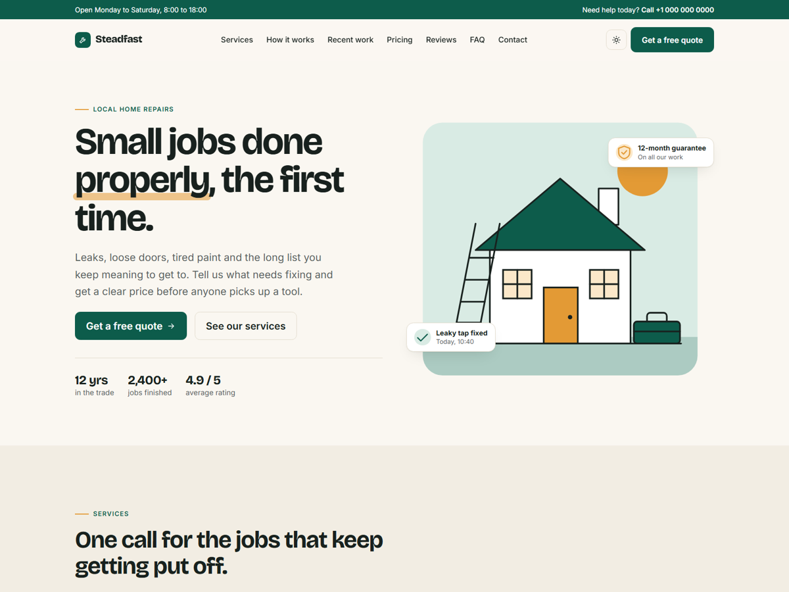

# Steadfast: an Eleventy starter for small service businesses

A one-page site for tradespeople, repair shops, cleaners, gardeners and anyone else who sells their time locally. All the text lives in one data file, so you can launch without touching a template.



**[Live demo](https://ello-lithuania.github.io/steadfast-eleventy/)**

## Features

- Sections for hero, services, process, recent work, pricing, reviews, FAQ, contact and a call to action
- All content in `src/_data/site.json`
- Every section is optional: delete its key and it disappears from the page
- Light and dark modes that follow the system setting, with a manual toggle
- Fully responsive, tested down to 375 px
- Contact form with browser validation that posts to any form service or backend
- Bootstrap 5.3 included locally, no jQuery and no CSS build step

## Getting started

```sh
git clone https://github.com/ello-lithuania/steadfast-eleventy.git my-site
cd my-site
npm install
npm start
```

Then open the local address that Eleventy prints. Run `npm run build` to generate the finished site in `_site/`.

## Editing the content

Everything is in `src/_data/site.json`:

| Key | What it controls |
|---|---|
| `title`, `description` | Page title and meta description |
| `brand`, `brand_icon`, `tagline` | Name, icon and footer text |
| `phone`, `phone_href`, `email` | Contact details, used in the header, contact section and footer |
| `nav`, `footer_columns` | Navigation links |
| `hero`, `services`, `process`, `work`, `pricing`, `reviews`, `faq`, `contact`, `cta` | Page sections |

The reviews in the demo are placeholder text. Replace them with real reviews from your own customers.

Available icons: `wrench`, `bolt`, `drop`, `brush`, `door`, `leaf`, `check`, `phone`, `mail`, `pin`, `clock`, `shield` and `star`.

To use photos instead of illustrations, put them in `src/assets/` and set `image` and `image_alt` on `hero` or on an item in `work.items`, for example `"image": "/assets/kitchen.jpg"`.

## Contact form

Without any setup, the form only validates in the browser and shows a demo message. Set `contact.form_action` to your form service or backend to start receiving messages.

## Colours and fonts

The colours are CSS variables named `--sf-*` at the top of `src/assets/css/style.css`, one set for light mode and one for dark mode. Fonts (Bricolage Grotesque and Inter) load from Google Fonts in `src/_includes/base.njk`.

## Deploying to a subfolder

Set the `PATH_PREFIX` environment variable when building, for example `PATH_PREFIX=/my-site/ npm run build`. The included GitHub Actions workflow does this for GitHub Pages.

## Credits

Designed and built by [KokybiskaSvetaine.lt](https://kokybiskasvetaine.lt/). The footer credit can be turned off with `"credit": false`.

Uses [Eleventy](https://www.11ty.dev/), [Bootstrap](https://getbootstrap.com/) (MIT), [Bricolage Grotesque](https://fonts.google.com/specimen/Bricolage+Grotesque) and [Inter](https://fonts.google.com/specimen/Inter) (SIL Open Font License).

## Licence

MIT. See [LICENSE](LICENSE).
